# DRAFT ENTITY RELATIONSHIP DIAGRAM (ERD) & SKEMA DIMENSIONAL DATA MART
**Proyek Capstone Data Engineering — Group A03**  
**Versi:** 1.1 (Updated & Verified with SRC-01..SRC-13 Complete Snapshot)  
**Status Dokumen:** Terverifikasi Penuh terhadap `SNAPSHOT_MANIFEST.md` & `ref_supply_corridor.csv` (PostgreSQL 16 DDL Ready)

---

## 1. Pendahuluan dan Paradigma Pemodelan

Berdasarkan analisis karakteristik 13 sumber data logis (22 tabel fisik) yang terbentang lintas domain harga pangan, pengamatan iklim sentra, nilai tukar valas, tarif energi, dan kebijakan HET, model data konseptual dan fisikal dirancang menggunakan arsitektur **Fact Constellation (Galaxy Schema)**. 

### Karakteristik Utama Desain:
1. **Conformed Dimensions:**  
   Tabel dimensi seperti `dim_date_hbkn`, `dim_commodity`, dan `dim_region` digunakan bersama secara konsisten (*conformed*) oleh seluruh tabel fakta untuk memungkinkan *cross-drilling* dan analisis korelasi multi-domain tanpa ambiguitas.
2. **Pencegahan Double Counting Spasial:**  
   Harga murni pasar konsumen DKI Jakarta dan harga produsen sentra dipelihara pada tabel fakta atomik `fact_food_price_daily` dengan kardinalitas tepat satu baris per komoditas per tingkat pasar per hari. Hubungan koridor pasokan banyak-ke-banyak dimodelkan secara terpisah melalui `bridge_supply_corridor` dan tabel fakta analitik `fact_food_supply_daily`.
3. **Penanganan Regulasi Berubah Perlahan (SCD Type-2):**  
   Tabel `dim_regulation_het` dan `dim_macro_logistics` memiliki atribut pelacakan riwayat versi (`valid_from`, `valid_to`, `is_current`) sehingga tidak ada histori regulasi yang tertimpa saat pemerintah menerbitkan perundang-undangan baru.

---

## 2. Diagram ERD (Mermaid Entity Relationship Diagram)

Berikut adalah representasi visual skema dimensional Data Mart:

```mermaid
erDiagram
    dim_date_hbkn ||--o{ fact_food_price_daily : "records_on (date_key)"
    dim_commodity ||--o{ fact_food_price_daily : "measures (commodity_key)"
    dim_market_tier ||--o{ fact_food_price_daily : "classified_by (market_tier_key)"
    dim_region ||--o{ fact_food_price_daily : "located_at (region_sk)"

    dim_date_hbkn ||--o{ fact_weather_daily : "observed_on (date_key)"
    dim_region ||--o{ fact_weather_daily : "station_at (region_sk)"

    dim_date_hbkn ||--o{ fact_macro_logistics_daily : "effective_on (date_key)"
    dim_macro_logistics ||--o{ fact_macro_logistics_daily : "governs_solar (solar_fuel_key)"
    dim_macro_logistics ||--o{ fact_food_supply_daily : "governs_logistics (solar_fuel_key)"

    dim_date_hbkn ||--o{ fact_food_supply_daily : "analyzed_on (date_key)"
    dim_commodity ||--o{ fact_food_supply_daily : "flows_commodity (commodity_key)"
    dim_region_corridor ||--o{ fact_food_supply_daily : "traverses_corridor (corridor_key)"
    dim_regulation_het ||--o{ fact_food_supply_daily : "governed_by (het_key)"

    dim_commodity ||--o{ bridge_supply_corridor : "allocates (commodity_key)"
    dim_region_corridor ||--o{ bridge_supply_corridor : "bridges (corridor_key)"
    dim_region ||--o{ dim_region_corridor : "originates_from (origin_region_sk)"
    dim_region ||--o{ dim_region_corridor : "terminates_at (dest_region_sk)"

    dim_date_hbkn {
        int date_key PK "YYYYMMDD"
        date full_date UK "ISO Date"
        int year "2022-2026"
        int month "1-12"
        varchar month_name "Januari..Desember"
        int day_of_month "1-31"
        varchar day_name "Senin..Minggu"
        boolean is_weekend "Flag Sabtu/Minggu"
        boolean is_holiday "Flag Hari Libur"
        varchar holiday_name "Nama Libur Resmi"
        varchar hbkn_category "RAMADAN/NATARU/NONE"
        boolean is_hbkn_major "Flag HBKN Utama"
    }

    dim_commodity {
        smallint commodity_key PK "Serial Key"
        varchar commodity_code UK "Slug misal beras"
        varchar commodity_name "Nama Komoditas Resmi"
        varchar category "Serealia/Hortikultura"
        varchar unit_of_measure "kg"
        boolean is_strategic "Flag 5 Komoditas Inti"
        boolean is_imported "Flag Impor (Bawang Putih)"
    }

    dim_market_tier {
        smallint market_tier_key PK "1:Produsen, 2:Trad, 3:Mod"
        varchar market_tier_code UK "produsen/tradisional/modern"
        varchar market_tier_name "Nama Tingkat Pasar"
        varchar price_stage "Hulu / Hilir"
    }

    dim_region {
        int region_sk PK "Surrogate Key"
        varchar region_key UK "Slug misal garut"
        varchar region_name "Kab. Garut / DKI Jakarta"
        varchar province_name "Jawa Barat / Jateng / DKI"
        varchar adm4_code "Kode BPS/Kemendagri"
        numeric latitude "Koordinat Lintang"
        numeric longitude "Koordinat Bujur"
        varchar role "SENTRA / KONSUMEN / PROVINSI"
    }

    dim_region_corridor {
        int corridor_key PK "Surrogate Key"
        varchar corridor_code UK "CRD-GARUT-JKT"
        varchar corridor_name "Garut - DKI Jakarta"
        int origin_region_sk FK "Relasi ke dim_region"
        int dest_region_sk FK "Relasi ke dim_region"
        varchar primary_commodity "Fokus Pasokan"
        varchar transport_route "Jalur Tol / Arteri"
        numeric distance_km "Jarak Tempuh Logistik"
    }

    dim_regulation_het {
        int het_key PK "Surrogate Key SCD Type 2"
        varchar reg_id "REG-01..REG-12"
        varchar komoditas "Beras/Cabai/Bawang"
        varchar varian_mutu "Medium/Premium/Umum"
        varchar jenis_batas "HET/HAP Konsumen"
        numeric batas_atas_rp "Plafon Maksimum Rp"
        varchar dasar_regulasi "Nomor Perbadan/Permendag"
        date valid_from "Awal Berlaku"
        date valid_to "Akhir Berlaku (9999-12-31)"
        boolean is_current "Status Terkini"
    }

    dim_macro_logistics {
        int fuel_key PK "Surrogate Key SCD Type 2"
        varchar bbm_id "BBM-01..BBM-04"
        varchar jenis_bbm "Biosolar / Pertalite"
        varchar kategori_bbm "JBT Subsidi / JBKP Penugasan"
        numeric harga_per_liter "Tarif Resmi Rp"
        varchar dasar_regulasi "Kepmen ESDM"
        date valid_from "Awal Berlaku"
        date valid_to "Akhir Berlaku"
        boolean is_current "Status Terkini"
    }

    bridge_supply_corridor {
        int bridge_id PK "Surrogate Key"
        varchar corridor_id UK "COR-01..COR-09 (SRC-12)"
        smallint commodity_key FK "Kunci Komoditas"
        int corridor_key FK "Kunci Koridor (Nullable COR-09)"
        varchar verification_status "OBSERVED_FDP / PROPOSED_UNVERIFIED"
        boolean active_for_join "TRUE hanya COR-01..04"
        numeric bobot_kontribusi_pasokan "Nullable (NULL di FDP 2024)"
        varchar evidence_row_ids "ID Bukti Bapanas FDP"
    }

    fact_food_price_daily {
        bigint price_fact_id PK "Serial Surrogate Key"
        int date_key FK "Kunci Tanggal"
        smallint commodity_key FK "Kunci Komoditas"
        smallint market_tier_key FK "Kunci Tingkat Pasar"
        int region_sk FK "Kunci Wilayah Observasi"
        numeric price_per_kg "Harga Rata-Rata Rp/kg"
        numeric prev_day_price "Harga Harian t-1"
        numeric daily_price_change_rp "Selisih Nominal Harian"
        numeric daily_price_change_pct "Perubahan Persentase"
        numeric ma14_price "Moving Average 14 Hari"
        numeric ma14_deviation_pct "Deviasi Persen thd MA14"
        timestamptz loaded_at "Audit Trail Pemuatan"
    }

    fact_weather_daily {
        bigint weather_fact_id PK "Serial Surrogate Key"
        int date_key FK "Kunci Tanggal"
        int region_sk FK "Kunci Wilayah Stasiun"
        numeric temperature_max_c "Suhu Maksimum Harian C"
        numeric precipitation_sum_mm "Presipitasi Harian mm"
        numeric rain_sum_mm "Curah Hujan Harian mm"
        numeric rolling_7d_precip_mm "Akumulasi Hujan 7 Hari"
        smallint is_extreme_rainfall "Flag Curah Hujan >=100mm"
        timestamptz loaded_at "Audit Trail Pemuatan"
    }

    fact_macro_logistics_daily {
        bigint macro_fact_id PK "Serial Surrogate Key"
        int date_key FK "Kunci Tanggal"
        int solar_fuel_key FK "Kunci Regulasi Solar (dim_macro_logistics)"
        int pertalite_fuel_key FK "Kunci Regulasi Pertalite (dim_macro_logistics)"
        numeric usd_idr_rate "Kurs JISDOR BI USD/IDR"
        numeric fx_daily_change_pct "Fluktuasi Kurs Harian"
        numeric solar_subsidi_rp "Tarif Solar per Liter"
        numeric pertalite_rp "Tarif Pertalite per Liter"
        timestamptz loaded_at "Audit Trail Pemuatan"
    }

    fact_food_supply_daily {
        bigint supply_fact_id PK "Serial Surrogate Key"
        int date_key FK "Kunci Tanggal"
        smallint commodity_key FK "Kunci Komoditas"
        int corridor_key FK "Kunci Koridor Pasokan"
        int het_key FK "Kunci Regulasi HET SCD-2"
        int solar_fuel_key FK "Kunci Regulasi Solar SCD-2"
        numeric producer_price_sentra "Harga Produsen Sentra"
        numeric consumer_price_dki "Harga Konsumen DKI Jakarta"
        numeric price_disparity_rp "Disparitas Harga Sentra-DKI"
        numeric distribution_margin_pct "Margin Keuntungan Dist %"
        numeric het_ceiling_price_rp "Plafon Maksimum HET/HAP"
        numeric price_vs_het_deviation_rp "Selisih Harga thd HET"
        numeric sentra_rolling_7d_rain_mm "Akumulasi Hujan Sentra"
        varchar early_warning_level "HIJAU/KUNING/MERAH"
        timestamptz loaded_at "Audit Trail Pemuatan"
    }
```



---

## 3. Data Definition Language (DDL) PostgreSQL 16 Lengkap

Berikut adalah skrip DDL idempoten untuk membuat seluruh tabel skema dimensional pada skema `curated`:

```sql
-- ============================================================================
-- DDL DATA MART GROUP A03: SKEMA CURATED (DIMENSIONAL MODEL)
-- Target RDBMS: PostgreSQL 16+
-- ============================================================================

CREATE SCHEMA IF NOT EXISTS curated;

-- ----------------------------------------------------------------------------
-- 1. TABEL DIMENSI TANGGAL & HBKN (dim_date_hbkn)
-- ----------------------------------------------------------------------------
CREATE TABLE IF NOT EXISTS curated.dim_date_hbkn (
    date_key INT PRIMARY KEY,                       -- Format: YYYYMMDD
    full_date DATE NOT NULL UNIQUE,
    year INT NOT NULL,
    quarter INT NOT NULL CHECK (quarter BETWEEN 1 AND 4),
    month INT NOT NULL CHECK (month BETWEEN 1 AND 12),
    month_name VARCHAR(20) NOT NULL,
    day_of_month INT NOT NULL CHECK (day_of_month BETWEEN 1 AND 31),
    day_of_week INT NOT NULL CHECK (day_of_week BETWEEN 1 AND 7),
    day_name VARCHAR(15) NOT NULL,
    is_weekend BOOLEAN NOT NULL,
    is_holiday BOOLEAN NOT NULL DEFAULT FALSE,
    holiday_name VARCHAR(150),
    hbkn_category VARCHAR(30) NOT NULL DEFAULT 'NONE', -- RAMADAN, IDUL_FITRI, IDUL_ADHA, NATARU, NONE
    is_hbkn_major BOOLEAN NOT NULL DEFAULT FALSE
);

CREATE INDEX IF NOT EXISTS idx_dim_date_full_date ON curated.dim_date_hbkn(full_date);
CREATE INDEX IF NOT EXISTS idx_dim_date_hbkn_cat ON curated.dim_date_hbkn(hbkn_category);

-- ----------------------------------------------------------------------------
-- 2. TABEL DIMENSI KOMODITAS (dim_commodity)
-- ----------------------------------------------------------------------------
CREATE TABLE IF NOT EXISTS curated.dim_commodity (
    commodity_key SMALLINT PRIMARY KEY,
    commodity_code VARCHAR(32) NOT NULL UNIQUE,
    commodity_name VARCHAR(80) NOT NULL,
    category VARCHAR(40) NOT NULL,
    unit_of_measure VARCHAR(20) NOT NULL DEFAULT 'kg',
    is_strategic BOOLEAN NOT NULL DEFAULT FALSE,
    is_imported BOOLEAN NOT NULL DEFAULT FALSE
);

-- ----------------------------------------------------------------------------
-- 3. TABEL DIMENSI TINGKAT PASAR (dim_market_tier)
-- ----------------------------------------------------------------------------
CREATE TABLE IF NOT EXISTS curated.dim_market_tier (
    market_tier_key SMALLINT PRIMARY KEY,
    market_tier_code VARCHAR(20) NOT NULL UNIQUE,
    market_tier_name VARCHAR(50) NOT NULL,
    price_stage VARCHAR(30) NOT NULL
);

-- ----------------------------------------------------------------------------
-- 4. TABEL DIMENSI WILAYAH & STASIUN (dim_region)
-- ----------------------------------------------------------------------------
CREATE TABLE IF NOT EXISTS curated.dim_region (
    region_sk INT PRIMARY KEY,
    region_key VARCHAR(32) NOT NULL UNIQUE,
    region_name VARCHAR(80) NOT NULL,
    province_name VARCHAR(60) NOT NULL,
    adm4_code VARCHAR(20),
    latitude NUMERIC(9,6),
    longitude NUMERIC(9,6),
    elevation_m NUMERIC(7,2),
    role VARCHAR(30) NOT NULL CHECK (role IN ('SENTRA_PRODUKSI', 'PASAR_KONSUMEN', 'PROVINSI_AGREGAT')),
    weather_station_key INT REFERENCES curated.dim_region(region_sk)
);

-- ----------------------------------------------------------------------------
-- 5. TABEL DIMENSI KORIDOR PASOKAN (dim_region_corridor)
-- ----------------------------------------------------------------------------
CREATE TABLE IF NOT EXISTS curated.dim_region_corridor (
    corridor_key INT PRIMARY KEY,
    corridor_code VARCHAR(32) NOT NULL UNIQUE,
    corridor_name VARCHAR(100) NOT NULL,
    origin_region_sk INT NOT NULL REFERENCES curated.dim_region(region_sk),
    dest_region_sk INT NOT NULL REFERENCES curated.dim_region(region_sk),
    origin_province_key VARCHAR(32) NOT NULL,
    primary_commodity VARCHAR(80) NOT NULL,
    transport_route VARCHAR(150) NOT NULL,
    distance_km NUMERIC(6,2),
    logistics_risk_category VARCHAR(20) DEFAULT 'Sedang'
);

-- ----------------------------------------------------------------------------
-- 6. TABEL DIMENSI REGULASI HET / HAP (dim_regulation_het - SCD Type 2)
-- ----------------------------------------------------------------------------
CREATE TABLE IF NOT EXISTS curated.dim_regulation_het (
    het_key INT PRIMARY KEY,
    reg_id VARCHAR(16) NOT NULL,
    komoditas VARCHAR(50) NOT NULL,
    varian_mutu VARCHAR(30) NOT NULL,
    jenis_batas VARCHAR(50) NOT NULL,
    batas_bawah_rp NUMERIC(10,2) NOT NULL DEFAULT 0.00,
    batas_atas_rp NUMERIC(10,2) NOT NULL,
    dasar_regulasi VARCHAR(150) NOT NULL,
    valid_from DATE NOT NULL,
    valid_to DATE NOT NULL DEFAULT '9999-12-31',
    is_current BOOLEAN NOT NULL DEFAULT TRUE,
    CONSTRAINT uq_het_version UNIQUE (komoditas, varian_mutu, jenis_batas, valid_from)
);

-- ----------------------------------------------------------------------------
-- 7. TABEL DIMENSI MAKRO & BAHAN BAKAR (dim_macro_logistics - SCD Type 2)
-- ----------------------------------------------------------------------------
CREATE TABLE IF NOT EXISTS curated.dim_macro_logistics (
    fuel_key INT PRIMARY KEY,
    bbm_id VARCHAR(16) NOT NULL,
    jenis_bbm VARCHAR(30) NOT NULL,
    kategori_bbm VARCHAR(50) NOT NULL,
    harga_per_liter NUMERIC(10,2) NOT NULL,
    dasar_regulasi VARCHAR(150) NOT NULL,
    valid_from DATE NOT NULL,
    valid_to DATE NOT NULL DEFAULT '9999-12-31',
    is_current BOOLEAN NOT NULL DEFAULT TRUE,
    CONSTRAINT uq_bbm_version UNIQUE (jenis_bbm, valid_from)
);

-- ----------------------------------------------------------------------------
-- 8. TABEL JEMBATAN KORIDOR PASOKAN (bridge_supply_corridor)
-- ----------------------------------------------------------------------------
CREATE TABLE IF NOT EXISTS curated.bridge_supply_corridor (
    bridge_id SERIAL PRIMARY KEY,
    corridor_id VARCHAR(16) NOT NULL UNIQUE,
    commodity_key SMALLINT NOT NULL REFERENCES curated.dim_commodity(commodity_key),
    corridor_key INT REFERENCES curated.dim_region_corridor(corridor_key),
    corridor_type VARCHAR(30) NOT NULL,
    verification_status VARCHAR(30) NOT NULL,
    active_for_join BOOLEAN NOT NULL DEFAULT FALSE,
    bobot_kontribusi_pasokan NUMERIC(5,4) CHECK (bobot_kontribusi_pasokan IS NULL OR (bobot_kontribusi_pasokan > 0 AND bobot_kontribusi_pasokan <= 1.0)),
    evidence_row_ids VARCHAR(80),
    source_url TEXT
);

-- ----------------------------------------------------------------------------
-- 9. TABEL FAKTA HARGA PANGAN HARIAN (fact_food_price_daily)
-- ----------------------------------------------------------------------------
CREATE TABLE IF NOT EXISTS curated.fact_food_price_daily (
    price_fact_id BIGSERIAL PRIMARY KEY,
    date_key INT NOT NULL REFERENCES curated.dim_date_hbkn(date_key),
    commodity_key SMALLINT NOT NULL REFERENCES curated.dim_commodity(commodity_key),
    market_tier_key SMALLINT NOT NULL REFERENCES curated.dim_market_tier(market_tier_key),
    region_sk INT NOT NULL REFERENCES curated.dim_region(region_sk),
    price_per_kg NUMERIC(12,2) NOT NULL CHECK (price_per_kg > 0),
    prev_day_price NUMERIC(12,2),
    daily_price_change_rp NUMERIC(12,2),
    daily_price_change_pct NUMERIC(6,2),
    ma14_price NUMERIC(12,2),
    ma14_deviation_pct NUMERIC(6,2),
    loaded_at TIMESTAMPTZ NOT NULL DEFAULT now(),
    CONSTRAINT uq_daily_price_grain UNIQUE (date_key, commodity_key, market_tier_key, region_sk)
);

CREATE INDEX IF NOT EXISTS idx_fact_price_date ON curated.fact_food_price_daily(date_key);
CREATE INDEX IF NOT EXISTS idx_fact_price_commodity ON curated.fact_food_price_daily(commodity_key);
CREATE INDEX IF NOT EXISTS idx_fact_price_region ON curated.fact_food_price_daily(region_sk);

-- ----------------------------------------------------------------------------
-- 10. TABEL FAKTA CUACA SENTRA HARIAN (fact_weather_daily)
-- ----------------------------------------------------------------------------
CREATE TABLE IF NOT EXISTS curated.fact_weather_daily (
    weather_fact_id BIGSERIAL PRIMARY KEY,
    date_key INT NOT NULL REFERENCES curated.dim_date_hbkn(date_key),
    region_sk INT NOT NULL REFERENCES curated.dim_region(region_sk),
    temperature_max_c NUMERIC(5,2),
    precipitation_sum_mm NUMERIC(7,2) NOT NULL DEFAULT 0.00,
    rain_sum_mm NUMERIC(7,2) NOT NULL DEFAULT 0.00,
    rolling_7d_precip_mm NUMERIC(8,2) NOT NULL DEFAULT 0.00,
    is_extreme_rainfall SMALLINT NOT NULL DEFAULT 0 CHECK (is_extreme_rainfall IN (0, 1)),
    loaded_at TIMESTAMPTZ NOT NULL DEFAULT now(),
    CONSTRAINT uq_daily_weather_grain UNIQUE (date_key, region_sk)
);

CREATE INDEX IF NOT EXISTS idx_fact_weather_date ON curated.fact_weather_daily(date_key);
CREATE INDEX IF NOT EXISTS idx_fact_weather_region ON curated.fact_weather_daily(region_sk);

-- ----------------------------------------------------------------------------
-- 11. TABEL FAKTA MAKRO & LOGISTIK HARIAN (fact_macro_logistics_daily)
-- ----------------------------------------------------------------------------
CREATE TABLE IF NOT EXISTS curated.fact_macro_logistics_daily (
    macro_fact_id BIGSERIAL PRIMARY KEY,
    date_key INT NOT NULL UNIQUE REFERENCES curated.dim_date_hbkn(date_key),
    solar_fuel_key INT REFERENCES curated.dim_macro_logistics(fuel_key),
    pertalite_fuel_key INT REFERENCES curated.dim_macro_logistics(fuel_key),
    usd_idr_rate NUMERIC(12,2) NOT NULL,
    fx_daily_change_pct NUMERIC(6,2),
    solar_subsidi_rp NUMERIC(10,2) NOT NULL,
    pertalite_rp NUMERIC(10,2) NOT NULL,
    loaded_at TIMESTAMPTZ NOT NULL DEFAULT now()
);

-- ----------------------------------------------------------------------------
-- 12. TABEL FAKTA TERINTEGRASI KORIDOR PASOKAN (fact_food_supply_daily)
-- ----------------------------------------------------------------------------
CREATE TABLE IF NOT EXISTS curated.fact_food_supply_daily (
    supply_fact_id BIGSERIAL PRIMARY KEY,
    date_key INT NOT NULL REFERENCES curated.dim_date_hbkn(date_key),
    commodity_key SMALLINT NOT NULL REFERENCES curated.dim_commodity(commodity_key),
    corridor_key INT NOT NULL REFERENCES curated.dim_region_corridor(corridor_key),
    het_key INT REFERENCES curated.dim_regulation_het(het_key),
    solar_fuel_key INT REFERENCES curated.dim_macro_logistics(fuel_key),
    producer_price_sentra NUMERIC(12,2) NOT NULL,
    consumer_price_dki NUMERIC(12,2) NOT NULL, -- Semi-additive reference across corridors
    price_disparity_rp NUMERIC(12,2) NOT NULL,
    distribution_margin_pct NUMERIC(6,2) NOT NULL,
    het_ceiling_price_rp NUMERIC(12,2),
    price_vs_het_deviation_rp NUMERIC(12,2),
    sentra_rolling_7d_rain_mm NUMERIC(8,2),
    early_warning_level VARCHAR(30) NOT NULL DEFAULT 'NORMAL',
    loaded_at TIMESTAMPTZ NOT NULL DEFAULT now(),
    CONSTRAINT uq_supply_corridor_grain UNIQUE (date_key, commodity_key, corridor_key)
);

CREATE INDEX IF NOT EXISTS idx_fact_supply_date ON curated.fact_food_supply_daily(date_key);
CREATE INDEX IF NOT EXISTS idx_fact_supply_commodity ON curated.fact_food_supply_daily(commodity_key);
CREATE INDEX IF NOT EXISTS idx_fact_supply_corridor ON curated.fact_food_supply_daily(corridor_key);
```

---

## 4. Validasi Integritas dan Kepatuhan Arsitektur

1. **Konsistensi terhadap Dokumentasi Grain:**  
   Setiap tabel fakta memiliki `CONSTRAINT UNIQUE` komposit yang secara ketat mencerminkan definisi *grain* pada Dokumen 01.
2. **Keterlacakan terhadap Business Key:**  
   Seluruh tabel dimensi memiliki kolom *natural key* dengan batasan `UNIQUE` serta *surrogate key* sebagai `PRIMARY KEY` bertipe numerik.
3. **Pemberian Hak Akses Berdasarkan RBAC Least Privilege:**  
   Sesuai `sql/postgres-init/03-capstone-infra.sql`:
   - Role `etl_writer`: Memiliki hak `INSERT, UPDATE, SELECT` penuh ke skema `curated`.
   - Role `tpid_analyst`: Diberikan hak `SELECT` murni untuk kepentingan kueri analitik dan pelaporan dashboard.

ERD dan DDL ini siap diintegrasikan langsung ke dalam pipeline otomatis Apache Hop serta repositori skrip inisialisasi PostgreSQL laboratorium.
